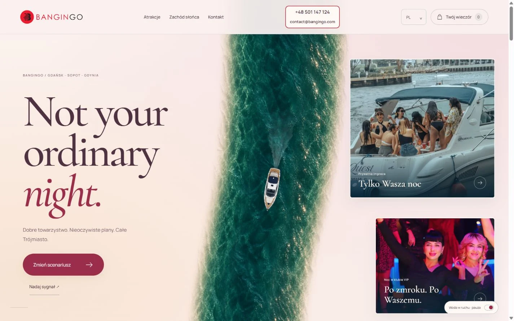

# Bangingo — Sunrise Rose

**Not your ordinary night.** A multilingual experience website for Gdańsk, Sopot and Gdynia, created by BonsAI Studio.

[Open Sunrise Rose](https://bangingo-client-choice.vercel.app/sunrise-rose.html) · [Bonsai Color Choice Kit](https://bangingo-client-choice.vercel.app/color-kit.html?version=atelier&palette=rose&background=sunset) · [BonsAI portfolio](https://itbonsai.pl/realizacje#bangingo)



## Selected edition

`sunrise-rose.html` opens River Atelier with the Champagne Rosé palette and Sunrise Rose background. Its defaults override previously saved colour choices; explicit `palette` and `background` URL parameters can still select another combination. Other editions and the review page remain available.

## Features

- A scroll-driven river with layered water flow and a constant-size yacht.
- Responsive layouts, reduced-motion support and a motion toggle.
- Polish, English, German, French, Spanish, Italian, Portuguese, Arabic, Japanese and Chinese.
- Fifteen activity ideas and a personal selection that prepares a WhatsApp or email message.
- Eight independent backgrounds and eight colour palettes in Bonsai Color Choice Kit.
- Local responsive images, self-hosted fonts and an optional yacht film.

## Run locally

Serve this directory with any static HTTP server. For example, with Python installed:

```sh
python -m http.server 4398 --bind 127.0.0.1
```

Then open `http://127.0.0.1:4398/sunrise-rose.html`. There is no build step, package installation or secret configuration. `vercel.json` describes the existing static preview deployment; provider account state is excluded.

## Project notes

Activity descriptions are programme inspiration, with availability and pricing arranged individually. Contact actions prepare a message for the visitor to send; there is no booking or payment backend. The preview deployment remains excluded from search indexing.

## Media and rights

Brand assets were provided for this project. Existing photographic source records are retained in `docs/photo-provenance.js`; photography uses the respective Pexels or Unsplash terms. Generated assets include the decorative yacht, Atelier water/wake and event-host imagery. The decorative river is not a geographic map. Manrope and Cormorant OFL notices are retained in `assets/`. No blanket licence is granted for third-party media or brand assets by publishing this repository.

## Verification

The Sunrise Rose entry is checked in responsive browser viewports. These checks do not constitute physical-device certification. The river is an animated canvas composition, not a fluid simulation.
