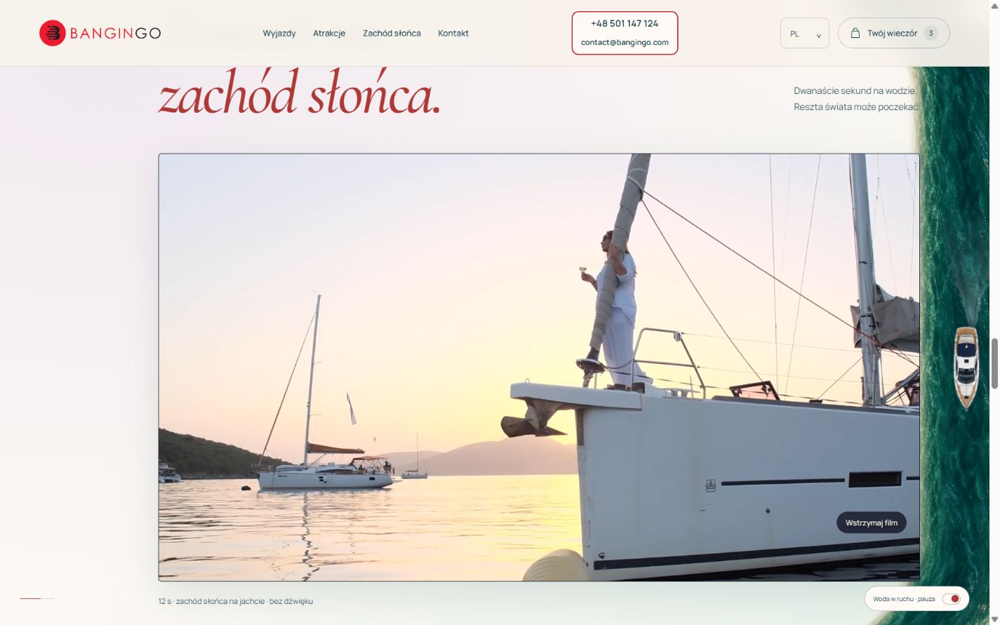

# Bangingo — Pearl Aurora

**Business. Leisure. Party?** Private trips and events in Poland, with Tricity experiences, created by BonsAI Studio. **Not your ordinary night** remains the brand motto.

[Open the final website](https://bangingo-client-choice.vercel.app/) · [Earlier design choices](https://bangingo-client-choice.vercel.app/choose.html) · [Bonsai Color Choice Kit](https://bangingo-client-choice.vercel.app/color-kit.html) · [BonsAI portfolio](https://itbonsai.pl/realizacje#bangingo)



## Selected edition

`index.html` and `pearl-aurora.html` are the final customer edition. They use Coastal Pearl colours and the Pearl Aurora background permanently, ignoring saved colour choices and colour parameters in the URL. `sunrise-rose.html` is retained as a compatible entry for existing portfolio links and now serves the same final edition. The colour kit and earlier variants remain separate review tools.

## Features

- A scroll-driven river with layered water flow and a constant-size yacht.
- Responsive layouts, reduced-motion support and a motion toggle.
- Polish, English, German, French, Spanish, Italian, Portuguese, Arabic, Japanese and Chinese.
- Automatic language from the Vercel IP-country header, with browser-language fallback. An explicit visitor choice takes priority and persists; selecting Auto returns to country detection. No GPS permission or third-party geolocation API is used. Country depends on the connection location (including VPNs); unsupported countries fall back to browser language, then English. Multilingual countries use the browser preference among their supported languages.
- Seven packages with individual pages: Business Trip, Corporate Event, Bachelor / Stag Weekend, Ladies’ Paradise, Party Animal, Love Surprise and Bromance.
- A five-field enquiry plus package selection. It builds an email draft for the visitor to send, and never claims that an enquiry was sent automatically. Form details are not saved in localStorage or submitted to the locale endpoint.
- Fifteen activity ideas and a personal selection that prepares an email message. Contact is exclusively through contact@bangingo.com; no telephone number or WhatsApp action is shown.
- Eight independent backgrounds and eight colour palettes in Bonsai Color Choice Kit.
- Local responsive images, self-hosted fonts and an optional yacht film.

## Run locally

Use Vercel CLI for both the static website and the small locale endpoint:

```sh
vercel dev
```

Open the local address printed by the CLI. The country header is supplied on Vercel deployments; local development falls back to browser language. A plain static server also renders the site but has no country endpoint. There is no frontend build step, third-party runtime dependency or secret configuration. Provider account state is excluded from this repository.

Run the language, API and content checks with `node --test tests/locale.test.mjs`. Country detection follows [Vercel's geolocation headers](https://vercel.com/kb/guide/geo-ip-headers-geolocation-vercel-functions); `/api/locale` uses `private, no-store` to prevent one visitor's locale being cached for another.

## Project notes

Activity descriptions are programme inspiration, with availability and pricing arranged individually. Contact actions prepare a message for the visitor to send; there is no booking or payment backend. The preview deployment remains excluded from search indexing.

## Media and rights

Brand assets were provided for this project. Existing photographic source records are retained in `docs/photo-provenance.js`; photography uses the respective Pexels or Unsplash terms. Generated assets include the decorative yacht, Atelier water/wake and event-host imagery. The decorative river is not a geographic map. Manrope and Cormorant OFL notices are retained in `assets/`. No blanket licence is granted for third-party media or brand assets by publishing this repository.

## Verification

The final entry is checked at 375, 768 and 1440 CSS pixels in all ten languages; all seven package pages are checked in ten languages at phone width. Browser checks include the enquiry draft, language persistence, Auto, simulated PL/JP country responses, the film, selection dialog and moving water. These checks do not constitute physical-device certification. The river is an animated canvas composition, not a fluid simulation. The existing temporary deployment remains noindex.
